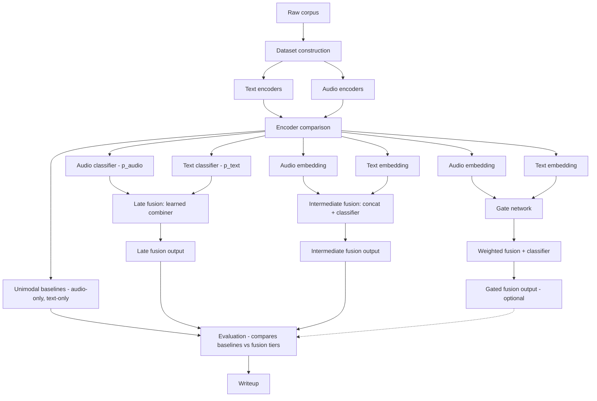

# 2026-09-06

## Goal

(Almost) Finish the proposal.
## Work

Just hammering away, I suppose.
## Results

Here's the flowchart Claude gave me.

I'll call it a day now. Listing what I've done sounds hellish, but here it goes.
- Expected Results
- Materials and Workplace
- Data Analysis
- Personal History
- Some of the bibliography
## Problems

Had a battle with Thai segmentation.
## What I learned

## Decisions

Changed compiler to XeLaTeX.
## Why

Apparently, with polyglossia, it has better word segmentation for Thai. I'll experiment with LuaLaTeX + babel for the next opportunity.
## Next

Abstract and Intro polishing. Writing up Research Plan, AI-declaration and the keywords and definitions.